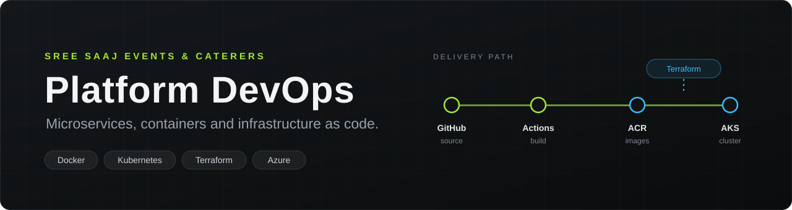
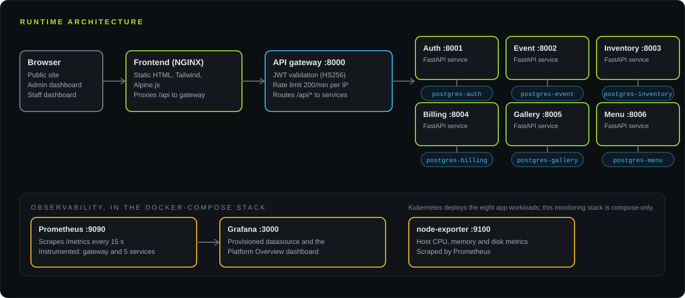
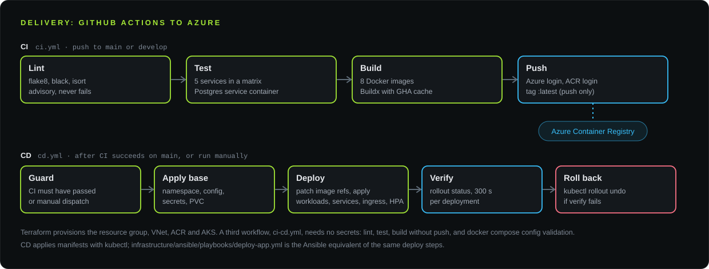

<div align="center">



<br />

**A microservices platform for Sree Saaj Events & Caterers, Kerala.**
Eight application images, a CI/CD pipeline to Azure, Terraform-provisioned AKS, Kubernetes manifests, Ansible deploy playbooks and a Prometheus and Grafana stack.

<br />


[Overview](#overview) · [Architecture](#architecture) · [Local stack](#run-it-locally) · [CI/CD](#cicd) · [Terraform](#infrastructure-as-code-terraform-on-azure) · [Kubernetes](#kubernetes) · [Ansible](#ansible) · [Monitoring](#monitoring) · [Status](#status-and-known-gaps)

</div>

<br />

## Overview

The application manages an events and catering business: events and bookings, inventory per event, invoices and payments, a photo gallery and a menu, behind a public website, an admin dashboard and a staff dashboard. This repository holds the application and everything around it: how it is containerised, built, provisioned, deployed and observed.

| Area | Tooling | Where |
| --- | --- | --- |
| Services | Python, FastAPI, SQLAlchemy, PostgreSQL | [`services/`](services) |
| Frontend | Static HTML, Tailwind CSS and Alpine.js (via CDN), NGINX | [`frontend/`](frontend) |
| Containers | Docker, Docker Compose | `*/Dockerfile`, [`docker-compose.yml`](docker-compose.yml) |
| CI/CD | GitHub Actions: build and push to Azure Container Registry, deploy to AKS | [`.github/workflows/`](.github/workflows) |
| Infrastructure | Terraform (`azurerm`): resource group, VNet, ACR, AKS | [`infrastructure/terraform/`](infrastructure/terraform) |
| Orchestration | Kubernetes manifests: 8 deployments, services, ingress, 8 HPAs, PVC | [`infrastructure/kubernetes/`](infrastructure/kubernetes) |
| Automation | Ansible playbook for AKS deploys, plus self-managed host playbooks | [`infrastructure/ansible/`](infrastructure/ansible) |
| Monitoring | Prometheus, Grafana, node-exporter | [`monitoring/`](monitoring) |

## Architecture

<p align="center">
  
</p>

The API gateway ([`services/api-gateway/main.py`](services/api-gateway/main.py)) validates JWTs, applies a 200 requests per minute limit per client address, and proxies `/api/*` to the service that owns the route. These path prefixes are public and need no token: `/api/auth/login`, `/api/auth/refresh`, `/api/bookings/`, `/api/gallery/`, `/api/menu/categories`, `/api/menu/items`, `/health` and the API docs.

| Service | Port | Responsibility | Database |
| --- | :-: | --- | --- |
| `api-gateway` | 8000 | JWT validation, rate limiting, routing, aggregated `/health` | none |
| `auth-service` | 8001 | Login, refresh, registration, users and roles | `auth_db` |
| `event-service` | 8002 | Events, calendar, event staff, booking inquiries | `event_db` |
| `inventory-service` | 8003 | Inventory items, low-stock list, assignment to events | `inventory_db` |
| `billing-service` | 8004 | Invoices, payments, revenue summary, invoice PDF | `billing_db` |
| `gallery-service` | 8005 | Image upload and gallery categories | `gallery_db` |
| `menu-service` | 8006 | Menu categories and items | `menu_db` |

Every service exposes `/health`. The gateway serves Swagger UI at `/api/docs`.

## Run it locally

**Requirements:** Docker Desktop with Compose v2.

```bash
git clone https://github.com/AdwaithSaji/sree-saaj-devops-.git
cd sree-saaj-devops-
docker compose up --build        # add -d to run in the background
```

| Component | URL |
| --- | --- |
| Website | [http://localhost](http://localhost) |
| API gateway and Swagger UI | [http://localhost:8000/api/docs](http://localhost:8000/api/docs) |
| Services (direct, for development) | `http://localhost:8001` to `http://localhost:8006` |
| Prometheus | [http://localhost:9090](http://localhost:9090) |
| Grafana | [http://localhost:3000](http://localhost:3000) |

**Credentials.** The compose file contains development-only database and Grafana credentials. The auth service creates a default admin account on first start (see `seed_admin` in [`services/auth-service/main.py`](services/auth-service/main.py)); change its password straight away. Replace all development values before any real deployment.

## CI/CD

<p align="center">
  
</p>

| Workflow | Trigger | What it does |
| --- | --- | --- |
| [`ci.yml`](.github/workflows/ci.yml) | Push to `main` or `develop`; PRs to `main` | Lint (flake8, black, isort), test five services against Postgres, then on push build eight images and push them to ACR as `:latest` |
| [`cd.yml`](.github/workflows/cd.yml) | CI succeeded on `main`, or manual with `image_tag` and `environment` | Guard, apply namespace, config, secrets and PVC, patch image references and apply deployments, services, ingress and HPAs, verify each rollout (300 s), roll back with `kubectl rollout undo` if verification fails |
| [`ci-cd.yml`](.github/workflows/ci-cd.yml) | Push to `main` or `develop`; PRs to `main` | No-secrets variant: lint, test, build images without pushing, validate `docker-compose.yml` |

The deploy job targets the `production` GitHub environment, so it waits for approval if that environment has required reviewers. Required repository secrets are listed in [`.github/SECRETS.md`](.github/SECRETS.md): `AZURE_CREDENTIALS`, `ACR_LOGIN_SERVER`, `ACR_NAME`, `AKS_RESOURCE_GROUP` and `AKS_CLUSTER_NAME`.

## Infrastructure as code: Terraform on Azure

[`infrastructure/terraform/`](infrastructure/terraform) provisions, with remote state in Azure Blob Storage:

- a resource group and a VNet with an AKS subnet and network security group
- an Azure Container Registry (`Standard`, admin user disabled)
- an AKS cluster with an autoscaling system pool and an application node pool, plus a Log Analytics workspace
- an `AcrPull` role assignment so the cluster's kubelet identity can pull from the registry

Defaults: region `southindia`, Kubernetes 1.28, `Standard_D2s_v3` nodes, 2 to 5 nodes.

<details>
<summary><b>Provision and connect</b></summary>

Create the state storage once (see the comment block in [`main.tf`](infrastructure/terraform/main.tf)), then:

```bash
cd infrastructure/terraform
terraform init
terraform plan -out=tfplan
terraform apply tfplan

terraform output acr_login_server      # values for the GitHub secrets
terraform output kubeconfig_command    # az aks get-credentials ...
```

</details>

The `modules/eks` and `modules/vpc` directories (AWS) are present but not referenced by the root configuration.

## Kubernetes

[`infrastructure/kubernetes/`](infrastructure/kubernetes) contains the `sreesaaj` namespace, a ConfigMap, a Secret manifest, one Deployment per workload (gateway 3 replicas, others 2, with rolling updates, anti-affinity, probes, resource limits and dropped capabilities), ClusterIP services, an NGINX ingress with TLS annotations for `sreesaaj.com`, a PersistentVolumeClaim for gallery uploads, and a HorizontalPodAutoscaler for each of the eight workloads.

<details>
<summary><b>Apply by hand</b></summary>

```bash
az aks get-credentials --resource-group sreesaaj-production-rg --name sreesaaj-production-aks

kubectl apply -f infrastructure/kubernetes/namespace.yaml
kubectl apply -f infrastructure/kubernetes/configmap.yaml
kubectl apply -f infrastructure/kubernetes/secrets.yaml
kubectl apply -f infrastructure/kubernetes/storage.yaml
kubectl apply -f infrastructure/kubernetes/deployments/
kubectl apply -f infrastructure/kubernetes/services/all-services.yaml
kubectl apply -f infrastructure/kubernetes/ingress.yaml
kubectl apply -f infrastructure/kubernetes/hpa.yaml

kubectl get pods,services,ingress -n sreesaaj
```

</details>

## Ansible

[`playbooks/deploy-app.yml`](infrastructure/ansible/playbooks/deploy-app.yml) performs the AKS deploy from a control machine: pre-flight checks, `az aks get-credentials`, apply manifests with image references rewritten to ACR and the chosen tag, then verify rollouts and list pods, services and ingress.

```bash
cd infrastructure/ansible
ansible-galaxy collection install -r requirements.yml
pip install -r pip-requirements.txt
az login
ansible-playbook playbooks/deploy-app.yml -e "image_tag=latest"
```

`install-docker.yml` and `install-kubernetes.yml` target self-managed Ubuntu hosts (the latter expects `k8s_master` and `k8s_workers` groups). The current inventory defines only the local AKS deployer, so those two need an inventory of your own.

## Monitoring

Prometheus scrapes the gateway and services at `/metrics` every 15 seconds, plus node-exporter. Grafana is provisioned with the Prometheus datasource and the **Sree Saaj Platform Overview** dashboard: service up/down, request rate, p95 response time, CPU and memory. This stack is defined in `docker-compose.yml` only; the Kubernetes manifests do not deploy it.

## API reference

All calls go through the gateway under `/api`.

| Area | Routes |
| --- | --- |
| Auth | `POST /auth/login`, `/auth/refresh`, `/auth/register`, `/auth/change-password`; `GET /auth/me`, `/auth/users`; `PUT /auth/users/{id}/deactivate` |
| Events | `GET`, `POST /events/`; `GET /events/calendar`; `GET`, `PUT`, `DELETE /events/{id}`; `GET`, `POST /events/{id}/staff` |
| Bookings | `POST`, `GET /bookings/`; `PUT /bookings/{id}/status` |
| Inventory | `GET`, `POST /inventory/`; `GET /inventory/low-stock`; item `GET`, `PUT`, `DELETE`; `POST`, `GET /inventory/events/{id}…` |
| Billing | `GET`, `POST /invoices/`; `GET`, `PUT /invoices/{id}`; `PUT …/status`; `POST …/payments`; `GET …/pdf`; `GET /billing/summary` |
| Gallery | `GET /gallery/`, `/gallery/categories`; `POST /gallery/`; `DELETE /gallery/{id}` |
| Menu | `GET`, `POST /menu/categories`; `GET`, `POST /menu/items`; item `GET`, `PUT`, `DELETE` |

`GET /health` on the gateway reports each service's status.

## Status and known gaps

This is a working demonstration of the delivery toolchain, and a few pieces do not yet line up. They are listed here so nobody trips over them.

- **Image tags.** CI pushes `:latest` only, while an automatic CD run asks for `sha-<7 characters>`. Run CD manually with `image_tag` set to `latest`, or add a commit-SHA tag to the CI push.
- **Image pull policy.** Every deployment manifest sets `imagePullPolicy: Never` with a local image name. CD and Ansible rewrite the image reference to ACR but not the pull policy, so change it (for example to `IfNotPresent`) before deploying to AKS.
- **Databases on AKS.** The Kubernetes secret points at `postgres-<service>` hosts, but PostgreSQL is only defined in Docker Compose; there are no database manifests for the cluster.
- **Ingress prerequisites.** `ingress.yaml` expects an NGINX ingress controller and cert-manager with a `letsencrypt-prod` issuer; neither is installed by this repository.
- **Quality gates.** Lint steps never fail the build (`|| true`), and no service has a `tests/` directory yet, so the test jobs currently run nothing.
- **Metrics coverage.** `auth-service` does not expose `/metrics`, and the Prometheus config scrapes a `cadvisor` target that the compose file does not define.
- **Auth service container.** It starts uvicorn with `--reload`; the other services use `--workers`.
- **Secrets.** Development credentials live in `docker-compose.yml` and `infrastructure/kubernetes/secrets.yaml`. The deploy workflow notes that Azure Key Vault with the CSI driver is the intended production approach.

## Repository structure

```text
.
├── services/              api-gateway and six FastAPI services, each with a Dockerfile
├── frontend/              static site, admin and staff dashboards, Dockerfile, nginx.conf
├── infrastructure/
│   ├── terraform/         Azure: resource group, VNet, ACR, AKS (modules/aks, modules/vnet)
│   ├── kubernetes/        namespace, config, secrets, deployments, services, ingress, HPA, PVC
│   ├── ansible/           deploy-app.yml, host-setup playbooks, inventory
│   └── nginx/             nginx.conf for the compose frontend
├── monitoring/            Prometheus config, Grafana provisioning and dashboard
├── .github/workflows/     ci.yml, cd.yml, ci-cd.yml
├── assets/readme/         README banner and diagrams
└── docker-compose.yml     local stack: 6 databases, 7 services, frontend, monitoring
```

---

<div align="center">
<sub>Sree Saaj Events &amp; Caterers · Kerala</sub>
</div>
